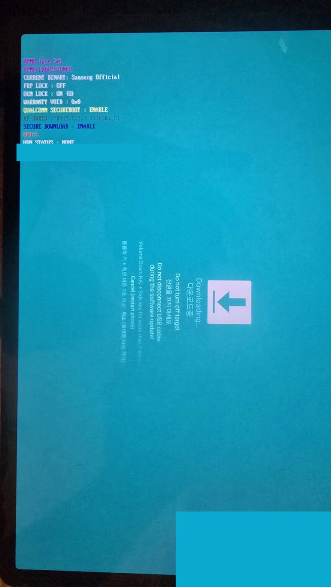

# Step 1 — Unlock the bootloader

[← Step 0: Before you start](00-before-you-start.md) · [Guide overview](../../README.md#step-by-step-guide) · [Step 2: Root with TWRP + Magisk →](02-root-twrp-magisk.md)

> **Goal:** an unlocked bootloader and ADB access from the PC. **Time:** 15 min.
> **Where:** mostly the tablet.

> [!CAUTION]
> Irreversible: the Knox `WARRANTY_VOID` fuse goes from `0x0` to `0x1` (Samsung
> Pay, Secure Folder and Samsung Health stop working for good). The
> tablet is factory reset.

## Prerequisites

- [ ] [Step 0](00-before-you-start.md) done: tools installed, repo cloned, tablet on T970XXS7DXH1
- [ ] Tablet backed up
- [ ] Tablet connected to Wi-Fi and signed in to a Samsung account
- [ ] Battery above 50 %

## Actions

### 1. 📱 Enable OEM unlocking

1. Settings › About tablet › Software information › tap **Build number** 7 times
   (enter your PIN if asked). "Developer mode has been turned on."
2. Settings › Developer options › turn on **OEM unlocking** › confirm.

If the switch is missing, the Samsung account is too recent (up to 7 days) or the
tablet has not been online long enough. Stay connected and check again later.

### 2. 📱 Enter Download Mode and unlock

1. Power the tablet off completely.
2. Hold **Vol Down + Vol Up** and plug the USB cable (the PC end must be connected). A warning screen appears.
3. On this **first** warning screen, **long-press Vol Up (~7 s)**. The
   "Device unlock mode" screen appears.
4. Press **Vol Up** to confirm. The tablet wipes itself and reboots (several
   minutes, sometimes two reboots).

> [!IMPORTANT]
> The long press must happen on the **first** warning screen. A short press goes
> to Download Mode, where a long press does nothing, and the screen keeps showing
> `OEM LOCK : ON (U)`. This is the most common mistake, and most guides do not
> mention it.

<p align="center"><br><sub>Download Mode <b>before</b> the unlock: <code>OEM LOCK : ON (U)</code>, <code>WARRANTY VOID : 0x0</code>. After the unlock it reads <code>OFF</code> and <code>0x1</code>. (Device ID masked.)</sub></p>


### 3. 📱 Set the tablet up again

1. Go through the first-run setup and **connect to Wi-Fi** (skip the Samsung account if you like).
2. Settings › About tablet › Software information › tap **Build number** 7 times.
3. Settings › Developer options:
   - **OEM unlocking** is on and greyed out ("Bootloader is already unlocked");
   - turn on **USB debugging**.

### 4. 🖥️ + 📱 Authorise the PC

```bash
adb devices
```

On the tablet, an "Allow USB debugging?" dialog appears. Tick **Always allow
from this computer**, then tap **Allow**. Run `adb devices` again.

## Verify

```bash
adb devices                                   # R52N…    device
adb shell getprop ro.boot.verifiedbootstate   # orange          (= bootloader unlocked)
adb shell getprop ro.build.PDA                # T970XXS7DXH1
```

At each boot, the tablet now shows a yellow "The bootloader is unlocked" warning
for a few seconds. That is expected.

## If it fails

| Problem | Fix |
|---|---|
| Download Mode still says `OEM LOCK : ON (U)` | You long-pressed on the second screen. Power off and redo action 2 |
| No "Device unlock mode" screen after the long press | OEM unlocking was not enabled, or the tablet is not linked to an account yet. Redo action 1 |
| `adb devices` shows `unauthorized` | Unlock the tablet screen and accept the dialog. If it never appears: Developer options › Revoke USB debugging authorizations, then unplug and replug |
| `adb devices` shows nothing | Try another cable or port. `lsusb \| grep 04e8` must show a Samsung device |
| `no permissions (missing udev rules?)` | Add your user to the `plugdev` group (Debian/Ubuntu) or install the `android-udev` package (Arch), then replug |

---

[← Step 0: Before you start](00-before-you-start.md) · [Guide overview](../../README.md#step-by-step-guide) · [Step 2: Root with TWRP + Magisk →](02-root-twrp-magisk.md)
