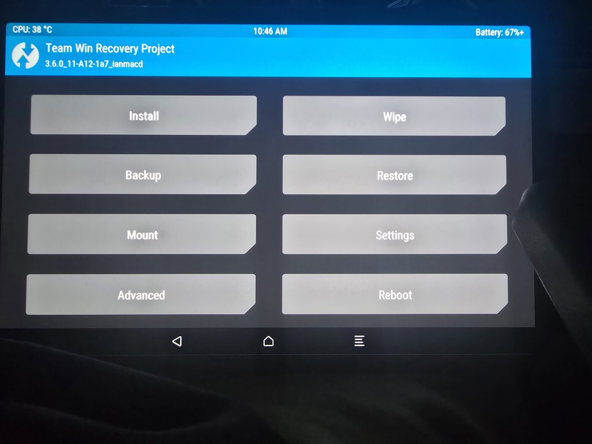
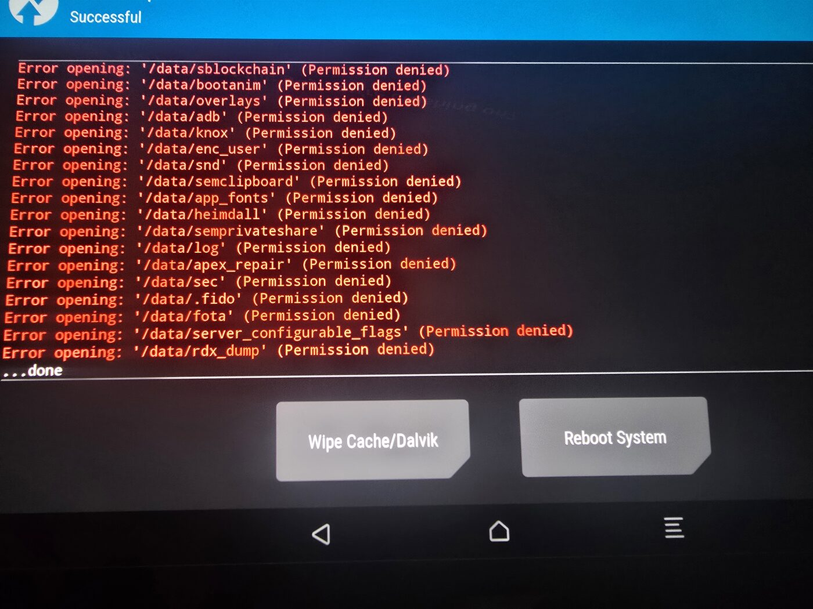
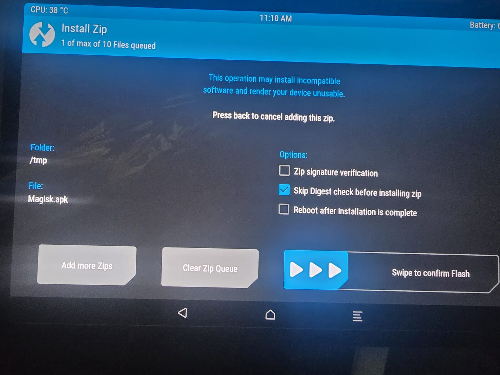
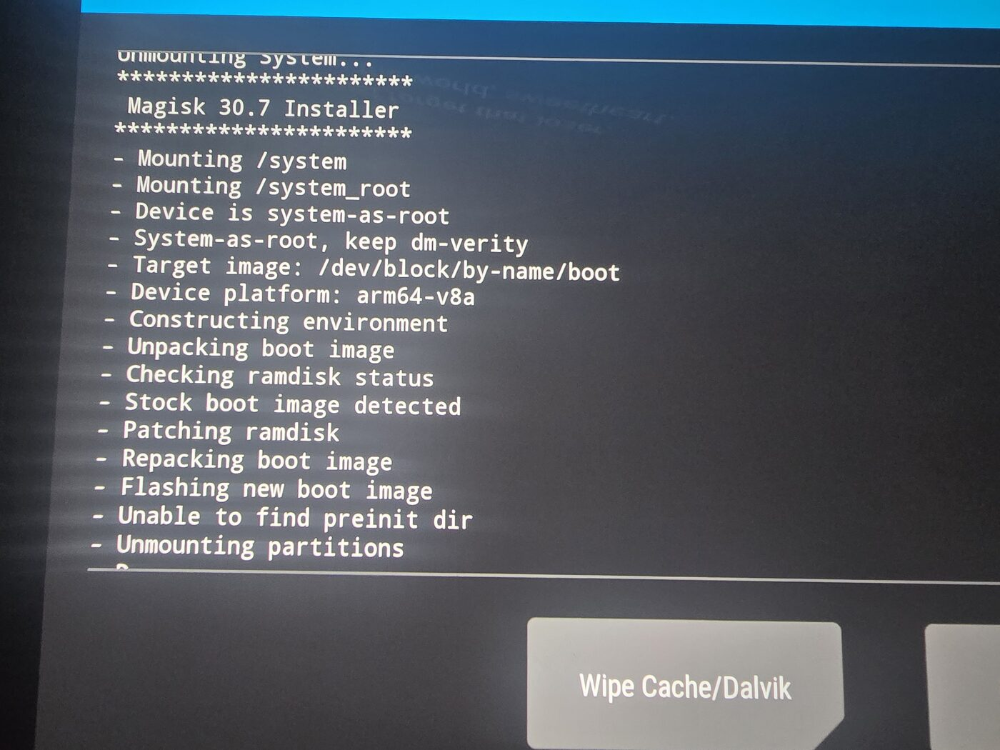
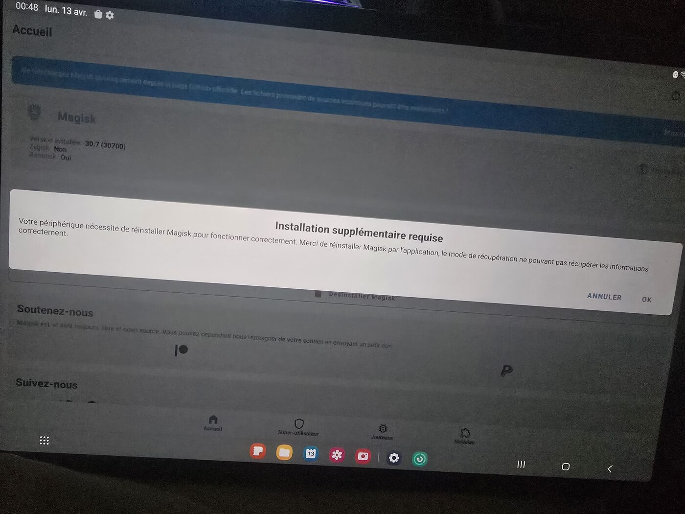

# Step 2 — Root with TWRP + Magisk

[← Step 1: Unlock the bootloader](01-unlock-bootloader.md) · [Guide overview](../../README.md#step-by-step-guide) · [Step 3: Build the kernel →](03-build-kernel.md)

> **Goal:** stock Android with Magisk root, and `adb shell su` working. **Time:** 20 min.
> **Where:** PC and tablet.

**Why root comes before the kernel:** Magisk gives `adb shell su`, `logcat`
and `/proc/config.gz` while the custom kernel runs. That is the only way to
diagnose a problem. The project lost weeks trying to debug a black-screen kernel
with no ADB. Root first, kernel second.

**Why TWRP:** on a Samsung with no root yet, a custom recovery is the simplest
way to install Magisk. TWRP is only a means to that end, and you won't need it
afterwards.

## Prerequisites

- [ ] [Step 1](01-unlock-bootloader.md) done — `adb shell getprop ro.boot.verifiedbootstate` prints `orange`
- [ ] `downloads/twrp-gts7xl-3.6.0_11-A12-1a7_ianmacd.img` and `downloads/Magisk-v30.7.apk` present — `sha256sum -c --ignore-missing SHA256SUMS`

## Actions

### 1. 🖥️ Generate the AVB-disabled vbmeta (once)

```bash
firmware/make-vbmeta-disabled.sh
sha256sum -c --ignore-missing SHA256SUMS | grep vbmeta     # firmware/vbmeta_disabled.img: OK
```

The first run builds the `sm8250-builder:v2` toolchain image (~3 min, reused in step 3).

```
Algorithm:                NONE
Flags:                    3
Written: …/firmware/vbmeta_disabled.img (4096 bytes)
```

This image turns Android Verified Boot off. Without it, the bootloader refuses
the unsigned TWRP, and later our unsigned `boot.img`
([details](../../firmware/README.md)).

### 2. 🖥️ Reboot into Download Mode and check heimdall

```bash
adb reboot download
heimdall detect                    # "Device detected"
```

### 3. 🖥️ Flash TWRP and the vbmeta

```bash
heimdall flash \
    --RECOVERY downloads/twrp-gts7xl-3.6.0_11-A12-1a7_ianmacd.img \
    --VBMETA   firmware/vbmeta_disabled.img \
    --no-reboot
```

Wait for `RECOVERY upload successful` and `VBMETA upload successful`.

### 4. 📱 Boot straight into TWRP

> [!IMPORTANT]
> On a normal Android boot, stock Samsung rewrites the recovery partition and
> TWRP is gone. Go **directly** from Download Mode to TWRP.

1. Unplug the USB cable.
2. Hold **Vol Down + Power** to leave Download Mode.
3. As soon as the screen goes black, switch to **Vol Up + Power**, and hold until TWRP appears.
4. Swipe "Allow modifications". Plug the USB cable back in.

<p align="center"><br><sub>TWRP 3.6.0_11-A12-1a7_ianmacd main menu.</sub></p>

`/data` stays encrypted in TWRP (it is an Android 12 build, and the tablet uses
Android 13 FBE). The `Permission denied` messages about `/data` are expected.

<p align="center"><br><sub>Expected: TWRP cannot read the encrypted <code>/data</code>. Nothing is wrong.</sub></p>

### 5. 🖥️ Push Magisk to TWRP

TWRP's **ADB Sideload is broken on this device**: the tablet disappears from USB
as soon as sideload starts. Push the file to `/tmp` instead (`/sdcard` is
encrypted, so it cannot be used):

```bash
adb devices                                         # R52N…    recovery
adb push downloads/Magisk-v30.7.apk /tmp/Magisk.apk
```

(The `.apk` is also a flashable zip. If TWRP's file list does not show it, push it as `/tmp/Magisk.zip` instead.)

### 6. 📱 Install Magisk from TWRP

1. **Install** › navigate to `/tmp` › `Magisk.apk` › **Swipe to confirm Flash**.

<p align="center"><br><sub>Folder <code>/tmp</code>, file <code>Magisk.apk</code>: swipe to flash.</sub></p>

2. The log ends with `Done!`. The `Unable to find preinit dir` warning is harmless on Samsung.

<p align="center"><br><sub>Magisk 30.7 installer: stock boot image detected, ramdisk patched, then the harmless <code>Unable to find preinit dir</code>.</sub></p>
3. **Reboot › System**. If TWRP offers to install its own app, decline.

### 7. 📱 Finish Magisk in Android

1. Open the **Magisk** app. If it is missing from the app drawer, run
   `adb install downloads/Magisk-v30.7.apk` on the PC.
2. Magisk asks for "Additional setup" (because of the preinit warning). Accept,
   or go to **Install › Direct Install (Recommended) › Let's go**. The tablet reboots.

<p align="center"><br><sub>Magisk 30.7 (30700) asks for "Additional setup required": tap OK and let it reinstall.</sub></p>

### 8. 🖥️ + 📱 Grant root to ADB

```bash
adb shell su -c id
```

A "Superuser request" popup appears on the tablet for **Shell**. Tap **Grant**
within ~10 s.

### 9. 🖥️ Back up the boot partition (your rollback)

Now that root works, save the current boot partition to the PC **before
changing anything else**. It is the stock kernel patched by Magisk, i.e. a
working, rooted tablet. Flashing it back from Download Mode always returns you
to this point.

```bash
mkdir -p output
adb shell "su -c 'B=/dev/block/by-name/boot; [ -e \$B ] || B=/dev/block/bootdevice/by-name/boot; \
  dd if=\$B of=/data/local/tmp/boot-backup.img && chmod 644 /data/local/tmp/boot-backup.img'"
adb pull /data/local/tmp/boot-backup.img output/boot-backup-magisk-stock.img
adb shell "su -c 'rm /data/local/tmp/boot-backup.img'"
ls -lh output/boot-backup-magisk-stock.img          # 68M (the whole partition)
```

Keep this file somewhere safe, outside `output/` if you ever clean the build directory.

> [!NOTE]
> **Why only now?** The boot partition cannot be read without root: Android
> refuses, and heimdall can only *write* partitions (its old `dump` command was
> removed in 2013). The untouched **stock** boot image therefore comes from
> Samsung's firmware. `scripts/fetch-downloads.sh` already put it in
> `downloads/T970XXS7DXH1-boot.img.lz4` (step 0).

<details>
<summary>Optional: Magisk's own copy of the original boot image</summary>

When Magisk installs itself directly (action 7), it keeps the original image in
`/data/magisk_backup_<SHA-1 of the stock image>/boot.img.gz` (used by Magisk ›
Uninstall › Restore images). For T970XXS7DXH1, that SHA-1 is
`f77599b57675bc32148ff66e2ba2a8cdd4e55bee`. If the directory exists, it proves
the tablet's original boot image is exactly the one in `downloads/`:

```bash
adb shell "su -c 'ls -d /data/magisk_backup_*'"
# /data/magisk_backup_f77599b57675bc32148ff66e2ba2a8cdd4e55bee   ← same firmware as downloads/
lz4 -dc downloads/T970XXS7DXH1-boot.img.lz4 | sha1sum              # f77599b5…  (the stock image)
```

A different name means your tablet ran another firmware build: re-check step 0.
</details>

## Verify

```bash
adb shell su -c id                 # uid=0(root) gid=0(root) groups=0(root) context=u:r:magisk:s0
adb shell su -c 'magisk -V'        # 30700
adb shell uname -r                 # 4.19.113-…   (still the stock kernel)
ls -lh output/boot-backup-magisk-stock.img     # 68M
```

You are now on the stock kernel with root. **This is a stable fallback
state:** everything after this can be undone back to here.

## If it fails

| Problem | Fix |
|---|---|
| `heimdall detect` finds nothing / `ERROR: Failed to access device` | udev rule missing ([step 0, action 2](00-before-you-start.md)), or try `sudo heimdall …` |
| `ERROR: Protocol initialisation failed!` | Unplug the cable, power off (Vol Down + Power), re-enter Download Mode, run the flash command once without `heimdall detect` before it |
| Bootloader: `Only official released binaries are allowed to be flashed` | The unlock is not complete (Knox Guard / RMM state). Boot Android, stay on Wi-Fi for a while, check that OEM unlocking is on and greyed out, then retry |
| Android boots instead of TWRP, and TWRP is gone | You missed the switch to Vol Up + Power. Redo actions 2-4 |
| `adb devices` empty in TWRP | Replug the cable once TWRP is on screen. Never start ADB Sideload |
| No `su` popup / `Permission denied` | Magisk › Superuser › delete the **Shell** entry, run `adb shell su -c id` again and tap Grant quickly |
| Magisk app says "Installed: N/A" | Install › Direct Install. If that option is missing, redo actions 2-6 |

---

[← Step 1: Unlock the bootloader](01-unlock-bootloader.md) · [Guide overview](../../README.md#step-by-step-guide) · [Step 3: Build the kernel →](03-build-kernel.md)
