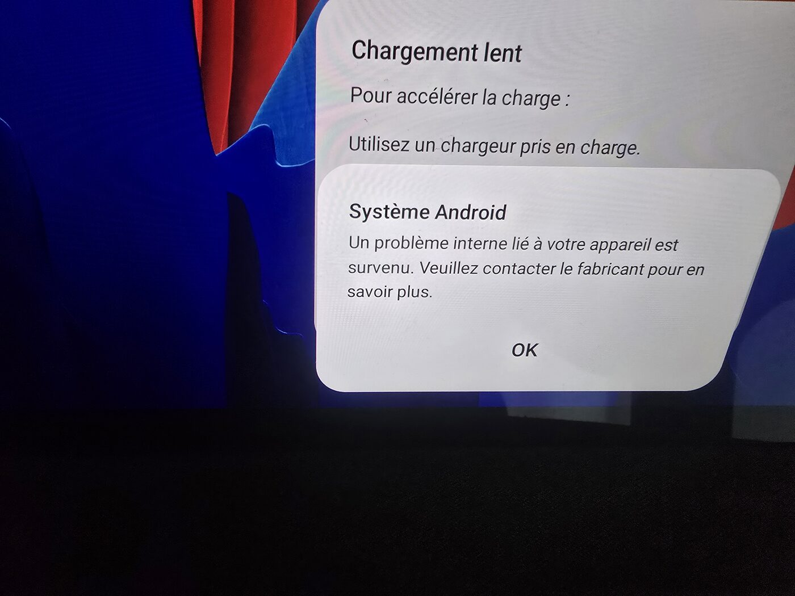

# Step 4 — Flash the kernel

[← Step 3: Build the kernel](03-build-kernel.md) · [Guide overview](../../README.md#step-by-step-guide) · [Step 5: Docker / Podman →](05-docker-podman.md)

> **Goal:** the tablet runs our kernel, with Magisk root still working. **Time:** 15 min.
> **Where:** PC and tablet.

Flashing `boot-custom.img` as is would **remove Magisk**, because Magisk lives
in the boot image. So the Magisk app patches our image first, and we flash the
result.

## Prerequisites

- [ ] [Step 2](02-root-twrp-magisk.md) done — `adb shell su -c id` prints `uid=0(root)`
- [ ] [Step 3](03-build-kernel.md) done — `ls -lh output/boot-custom.img` (~23M)
- [ ] `firmware/vbmeta_disabled.img` present (step 2, action 1) — `ls firmware/vbmeta_disabled.img`
- [ ] The rollback image from step 2, action 9 — `ls -lh output/boot-backup-magisk-stock.img`
- [ ] Battery above 50 %

## Actions

### 1. 🖥️ Check your rollback image

```bash
ls -lh output/boot-backup-magisk-stock.img          # 68M
```

This is the backup made at the end of step 2 (action 9): stock kernel + Magisk.
If it is missing, make it now with the commands of
[step 2](02-root-twrp-magisk.md), action 9 (the tablet is still on that same
image at this point).

### 2. 🖥️ Send our image to the tablet

```bash
adb push output/boot-custom.img /sdcard/Download/boot-custom.img
```

### 3. 📱 Patch it with Magisk

**Magisk › Install** (next to "Magisk") › leave the options as they are
(**Recovery Mode** unchecked) › **Select and Patch a File** ›
`Download/boot-custom.img` › **Let's go**. Wait for `All done!`.

### 4. 🖥️ Get the patched image back

```bash
PATCHED=$(adb shell 'ls -t /sdcard/Download/magisk_patched*.img' | head -1 | tr -d '\r')
echo "$PATCHED"
adb pull "$PATCHED" output/boot-custom-magisk.img
adb shell rm "$PATCHED" /sdcard/Download/boot-custom.img
```

### 5. 🖥️ Flash

```bash
adb reboot download
heimdall flash \
    --BOOT   output/boot-custom-magisk.img \
    --VBMETA firmware/vbmeta_disabled.img \
    --no-reboot
```

Wait for `BOOT upload successful`. Re-flashing the vbmeta with BOOT costs nothing
and avoids `Error verifying vbmeta image` if it was ever restored.

### 6. 📱 Reboot

Hold **Vol Down + Power** ~7 s. The yellow "unlocked" warning appears, then
Android boots (the first boot takes a bit longer).

## Verify

```bash
adb shell uname -r                 # 4.19.325-cip128-st12+   (stock was 4.19.113-…)
adb shell su -c id                 # uid=0(root) … — Magisk still there
adb shell su -c 'zcat /proc/config.gz' | grep -E '^CONFIG_(USER_NS|OVERLAY_FS)='
```

Full container check: run Docker's `check-config.sh` **on the PC**, against the
running config. On the tablet it fails because of toybox `zcat`.

```bash
adb shell su -c 'zcat /proc/config.gz' > output/running.config
curl -fsSL -o output/check-config.sh https://raw.githubusercontent.com/moby/moby/v27.3.1/contrib/check-config.sh
bash output/check-config.sh output/running.config
```

Expected: everything under *Generally Necessary* is `enabled`. Under *Optional*,
only `CONFIG_CGROUP_HUGETLB` and `CONFIG_BRIDGE_VLAN_FILTERING` are missing, and
neither is needed.

📱 On the tablet: the screen works, touch and S Pen work, and Settings › Display ›
Motion smoothness offers 120 Hz.

## First-boot settings

| Symptom | Cause | Fix |
|---|---|---|
| Popup "Android System: There is an internal problem with your device" | Samsung shows it when the running kernel is not the one it shipped. It appeared on the first boot of the custom kernel | Tap **OK**. Android works normally |
| Display stuck at 60 Hz, feels laggy | Power saving is on after a reset | Settings › Battery › Power saving off; Display › Motion smoothness › Adaptive |
| Closing the Book Cover no longer turns the screen off | Side effect of the patch (the cover is always reported open, otherwise the screen blanked with the S Pen docked) | Turn the screen off with the power button |

<p align="center"><br><sub>The "internal problem" popup (French UI) on the first boot of the custom kernel, 13 April 2026.</sub></p>

## If it fails

**The way back is always the same:** Download Mode (power off, Vol Down + Vol Up + USB, short Vol Up), then:

```bash
heimdall flash --BOOT output/boot-backup-magisk-stock.img --no-reboot
```

| Problem | Fix |
|---|---|
| `Error verifying vbmeta image` at boot | Flash again with `--VBMETA firmware/vbmeta_disabled.img` |
| Bootloop | Roll back as above. Check that `boot-custom.img` was built by `make-boot-img.sh` (stock cmdline) |
| "Retry / Factory reset" screen, `enablefilecrypto_failed` | FBE keys bound to the pre-unlock Root of Trust: do **one** factory reset ([why](../how-it-works.md#encryption-keys-and-the-root-of-trust)). Never needed again afterwards |
| `uname -r` still shows `4.19.113` | You flashed the backup, or the flash did not complete. Redo actions 4-6 |
| `su` gone after the flash | You flashed `boot-custom.img` instead of the Magisk-patched one. Redo actions 2-6 |
| Black screen with the S Pen docked, power button does nothing | The flashed kernel was built without the patch (its S Pen / cover part, in `hall_ic_wacom.c`). Undock the S Pen to get the screen back, then, shortly after a boot, check with `adb shell "su -c 'dmesg'" \| grep 'cover detection'` (empty = no fix; the patched driver logs it each time Android opens the sensor). Roll back, run the [step 3 Verify](03-build-kernel.md#verify) checks, rebuild and flash again |

More: [troubleshooting › kernel and flashing](../troubleshooting.md#kernel-and-flashing).

---

[← Step 3: Build the kernel](03-build-kernel.md) · [Guide overview](../../README.md#step-by-step-guide) · [Step 5: Docker / Podman →](05-docker-podman.md)
