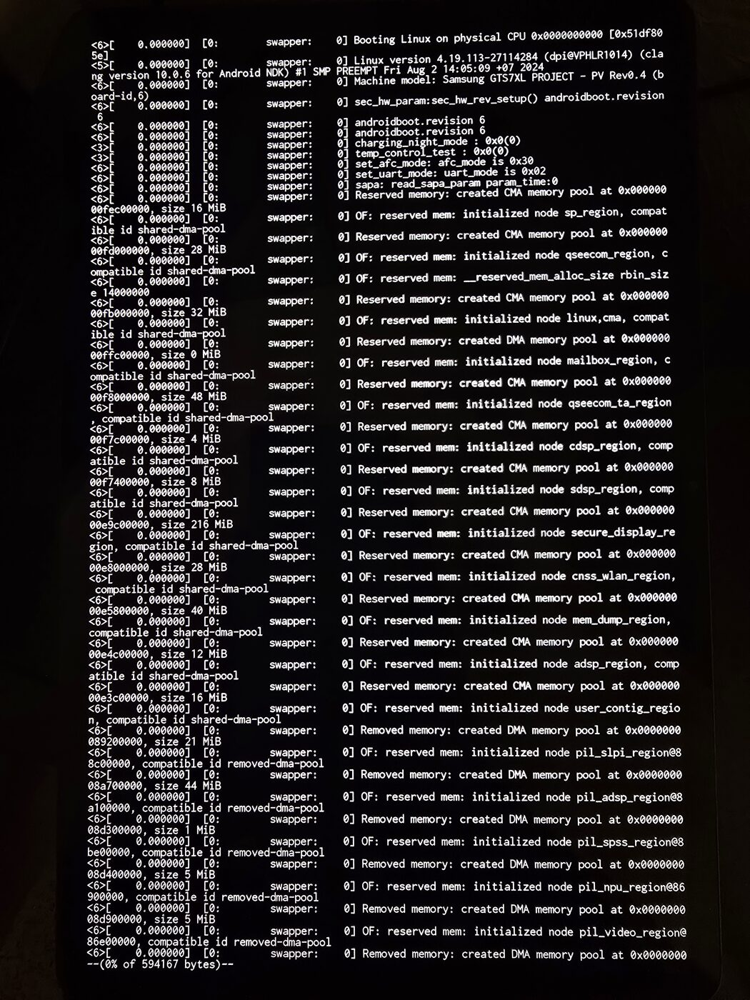

# Histoire du projet

[README](../README.md) · **Histoire du projet** · [Dossier de recherche](research/README.md) · [Récit complet](research/recit-complet.md) · [Journal de bord](research/journal.md) · [Slides expliquées](research/presentation/slides.md) · [Script](research/presentation/script.md) · [Présentation (HTML)](research/presentation/warranty-void.html)

*Récit en français. Le guide technique est en anglais.*

> Cette page est la version courte. Le **récit complet**, acte par acte, est dans
> [`research/recit-complet.md`](research/recit-complet.md), et le journal de bord
> jour par jour dans [`research/journal.md`](research/journal.md).

> Avril 2026 : 3 semaines, 27 `boot.img`, 29 `recovery.img`, ~2 600 lignes de
> journal. Tout ça pour taper `docker run` sur une tablette.

## Le point de départ

Une Galaxy Tab S7+ (SM-T970, Snapdragon 865, Android 13 / One UI 5.1.1). L'idée :
en faire un poste de dev mobile qui fait tourner des conteneurs **en local**,
plutôt que de passer par un VPN et un bureau distant vers une infra maison.

La configuration du kernel de cette tablette laisse plusieurs fonctions
indispensables aux conteneurs désactivées : namespaces utilisateur, PID et
réseau, cgroup `pids`, IPVS… Le code est bien présent dans les sources, il n'est
simplement pas compilé. Il faut donc recompiler un kernel en activant ces
options, puis flasher le résultat, et tout cela sans casser Android (stylet,
120 Hz, Wi-Fi, Bluetooth).

Pour les sources, l'arbre réellement utilisé (vérifié a posteriori, le journal
parlait de « sources Samsung ») est celui de LineageOS pour les appareils Samsung SM8250 (`android_kernel_samsung_sm8250`) : c'est le kernel
Samsung avec les mises à jour CIP 4.19 intégrées (4.19.325, contre 4.19.113 pour
le kernel stock). Il tourne ici sous l'Android 13 **stock** de Samsung : seul le
kernel change, pas la ROM.

```
 Activer les CONFIG  →  compiler (container clang-12)  →  boot.img  →  flasher
```

## Chronologie

| Phase | Versions | Ce qui s'est passé |
|---|---|---|
| Déverrouillage | — | `OEM LOCK : ON` en boucle : l'appui long Vol Haut se fait sur le **premier** écran d'avertissement. Knox grillé |
| Premier essai TWRP | — | Abandonné à tort : la recovery stock se réécrit au boot. `heimdall dump` n'existe plus depuis 2013 |
| Patch direct du boot.img | v1-v4 | Kernel + ramdisk et DTB stock. v1/v2 démarrent en recovery, v3/v4 bouclent. Découverte de **pstore** pour lire les logs du crash précédent |
| La fausse piste DTB | v5-v14 | DTB non compilés (Makefile commenté), puis sans `__symbols__`, puis nœud fstab ignoré… Chaque correctif est réel, mais aucun ne règle le problème |
| La vraie cause | v11 → **v15** | `force_normal_boot=1` dans la cmdline déclenche un `SwitchRoot` avant la lecture du fstab. On le retire, et **premier montage complet** des partitions |
| Chiffrement | v15-v17 | `enablefilecrypto_failed`. Ce n'était ni l'ICE ni le fstab : c'était un **mismatch du ROT** (clés FBE liées à l'état du bootloader). Un factory reset règle le problème |
| Écran noir et mur de l'ADB | v17-v27 | Android tourne (MTP visible) mais l'écran reste noir. Sans écran, pas d'ADB, et sans ADB, pas de diagnostic |
| Bataille de la recovery | recovery v1-v29 | Shell ADB dans la recovery Samsung contre SELinux. Victoire avec `magiskpolicy 'permissive adbd'` au bout de 29 versions |
| **Pivot** | — | Retour à l'état 0 : boot stock, **TWRP puis Magisk d'abord**, et le kernel ensuite |
| Écran noir résolu | v22 | Ce n'était pas le DRM mais le **capteur hall** du S Pen et de la cover, couplé au `CoverManager` de Samsung |
| Kernel validé | v22 | 50/52 options conteneur (les 2 manquantes sont inutiles), 120 Hz, root, ADB |
| Userland | — | proot, chroot et LXC échouent tous. Docker et Podman **natifs** sur Android fonctionnent |
| Finitions | — | Persistance au reboot, compose, chroot Ubuntu, XFCE, SSH et ConnectBot, scripts automatisés |

## Acte 1 — Comprendre pourquoi ça ne boote pas (v1-v15)

Le principe paraissait simple : remplacer le kernel dans le `boot.img` stock et
garder le reste. Les v1/v2 démarrent pourtant sur la recovery
(« Can't load Android system »). On ajoute `androidboot.force_normal_boot=1`, ce
que semble demander la doc AOSP, et on obtient un bootloop.

**pstore** change la donne : une zone de RAM qui survit au reboot. En redémarrant
sur le kernel stock, `/sys/fs/pstore/console-ramoops-0` donne enfin le log du
crash :

```
init: [libfs_mgr]ReadDefaultFstab(): failed to find device default fstab
init: execv("/system/bin/init") failed: No such file or directory
Kernel panic - not syncing: Attempted to kill init!
```

Suivent dix versions sur les device trees. Les DTB vendor ne sont pas compilés
(sous-dossier commenté dans le Makefile), puis ils le sont mais sans
`__symbols__`, de sorte que les 864 fixups du DTBO Samsung échouent en silence.
Un nœud `fstab_custom` est ignoré par init, puis un fstab réécrit dans le DTB fait
attendre init 10 secondes avant de mourir. Ce sont des vrais problèmes, mais ce
n'est pas *le* problème.

En v11, avec `loglevel=5`, une ligne passe :

```
init: Switching root to '/first_stage_ramdisk'
```

Mis en dur dans la cmdline, `force_normal_boot=1` provoque un `SwitchRoot` dans
l'init Samsung **avant** la lecture de `/fstab.qcom` : le fstab devient
inaccessible. L'ABL Qualcomm ajoute déjà ce flag dynamiquement, il ne fallait
donc pas l'écrire. En v15, avec la cmdline strictement stock, le premier montage
est complet :

```
[5.16s] init: Switching root to '/system'
[5.16s] init: init second stage started!
```

## Acte 2 — Le chiffrement et le ROT (v15-v17)

L'étape suivante échoue : `enablefilecrypto_failed`, puis la recovery qui propose
« Retry / Factory reset ». Deux versions sont passées à modifier le chiffrement
dans le fstab (ICE, puis AES logiciel, puis plus rien), sans aucun effet.

C'est `prev_dump.log` qui donne la réponse :

```
KeyStorage: checkRotStr current rot value : 07000200…
KeyStorage: checkRotStr saved rot value   : 06000200…
```

Le Keymaster Samsung lie les clés FBE au **Root of Trust**, calculé à partir de
l'état du bootloader et du compteur de déverrouillage. Les clés dataient
d'avant le déverrouillage. Il a suffi d'**un seul factory reset**, et comme le
ROT ne dépend pas du hash du `boot.img`, tous les kernels suivants ont démarré
sans y revenir.

## Acte 3 — L'écran noir et l'ADB (v17-v27, recovery v1-v29)

Après le reset, Android démarre (le MTP apparaît en USB) mais l'écran reste noir.
On ne peut donc pas activer le débogage USB, et on ne peut rien diagnostiquer
sans ADB. Les pistes testées :

- `adb_debug.prop` dans le ramdisk : le vendor init Samsung écrase la config USB ;
- `persist.sys.usb.config=mtp,adb` : écrasé lui aussi ;
- `androidboot.usb.config` dans la cmdline : ignoré par Samsung ;
- `CONFIG_FB_SIMPLE` : l'UI apparaît 0,5 s, ce qui montre que le kernel affiche
  bien quelque chose et que c'est l'userspace qui plante.

Faute d'ADB, les logs se lisaient… à l'écran, page par page, photographiés au
téléphone puis passés à l'OCR :

<p align="center"><br><sub>Une des dizaines de pages de log kernel photographiées le 9 avril pour l'OCR (ici le kernel stock 4.19.113).</sub></p>

Reste la recovery Samsung. Il faut patcher son ramdisk pour obtenir un shell ADB,
mais SELinux bloque tout : `selinux=0` est ignoré (`SELINUX_BOOTPARAM=n`), tout
comme `androidboot.selinux=permissive`. `setenforce` est annulé par le binaire
recovery, et un patch binaire d'adbd (`tbz` → `b`) fait juste passer de SIGABRT à
« Permission denied ». La solution est arrivée à la 29ᵉ version : modifier la
policy elle-même.

```bash
magiskpolicy --load sepolicy 'permissive adbd' \
  'allow adbd shell_exec file { execute execute_no_trans open read getattr }' --save sepolicy
```

On obtient enfin `adb pull /proc/last_kmsg` : 21 000 lignes, et plus jamais de photos. Elles montrent un
DRM parfaitement sain. Les erreurs `NULL attachment` suivies jusque-là venaient
du kernel *recovery*, pas du nôtre.

## Le pivot : root d'abord, kernel ensuite

À ce stade, presque tout le travail des semaines précédentes avait servi à
**compenser l'absence d'écran et d'ADB**, et non à faire tourner des conteneurs.
Tous ceux qui avaient réussi Docker sur Android avaient déjà root et ADB avant de
toucher au kernel.

Décision : **retour à l'état 0.** On reflashe le boot stock, on installe TWRP en
bootant directement dessus depuis le Download Mode (avant que la recovery stock
ne l'écrase), puis Magisk, puis le kernel custom **patché par Magisk**. Avec
`adb shell su` et `logcat` disponibles, la cause de l'écran noir a été trouvée en
une journée.

## Acte 4 — Le capteur hall (v22)

`getevent -l` révèle trois capteurs hall. Celui du S Pen et de la cover arrière,
`hall_wacom`, envoie `SW_MACHINE_COVER=1` dès qu'un aimant est proche : stylet
rangé, cover repliée, et même pendant l'utilisation du stylet. Le framework
Samsung éteint alors l'écran, puis **annule le réveil par le bouton power** :

```
D/PowerManagerService: !@Screen__On : Cancel (coverType: 0)
D/SEP_UNION_CoverManager: sendPowerKeyToCover
```

Le correctif est dans le driver `hall_ic_wacom.c` : on ne lit plus le GPIO et la
cover est toujours vue comme ouverte. En contrepartie, fermer une Book Cover ne
met plus la tablette en veille.

Le kernel v22 ne manque alors que deux options sans intérêt ici
(`CGROUP_HUGETLB`, `BRIDGE_VLAN_FILTERING`) au contrôle `check-config.sh`. Le
120 Hz fonctionne (c'est le mode économie d'énergie qui bloquait à 60 Hz après le
reset), et Magisk et ADB aussi. **La phase kernel est terminée.**

## Acte 5 — Les conteneurs : trois impasses avant le succès

| Essai | Résultat |
|---|---|
| Podman dans proot (Termux) | `ptrace` bloque `clone(CLONE_NEWUSER)` |
| Podman dans un vrai chroot | `remount /, flags 0x44000: invalid argument` : contrôle VFS en dur, confirmé par les mainteneurs |
| LXC dans un chroot | Marche **une fois**, puis `ENOKEY` : la clé fscrypt est absente du keyring après `pivot_root` |

La solution vient de l'article d'ivonblog (Docker sur un Xperia) : **pas de
chroot pour le daemon.** On lance des binaires statiques directement sur Android,
avec les données dans `/data/docker`, hors de la zone chiffrée par application.

Suit une longue série de « Android n'est pas POSIX » : `/` en lecture seule, pas
de `/run`, ni de `/dev/shm`, ni de `/etc/resolv.conf`, ni de CA, ni de
`/etc/passwd`, et des cgroups v2 vides. Chaque fois la parade est la même :
tmpfs ou bind-mount depuis `/data`, et reconstruction au boot par Magisk
`service.d`. `docker run hello-world` passe le 15 avril, `podman run` le même
jour, et la persistance multi-reboot est validée le soir même.

## Acte 6 — Du conteneur au poste de travail

- **Compose** : docker-compose pour les deux runtimes. Pour Podman, il a fallu
  déplacer `cgroups = "disabled"` de `[engine]` vers `[containers]`, la seule
  section lue par l'API REST.
- **Chroot Ubuntu 24.04** : Termux est piloté depuis le PC avec
  `su -G 3003 -G 9997 <uid>`, ce qui contourne à la fois le refus de root d'apt
  et le filtrage réseau Android. `resolv.conf` est rendu immuable avec `chattr +i`.
- **XFCE sur Termux:X11** : un pont `socat` entre socket abstrait et fichier, un
  DPI calibré pour l'écran 2800×1752, et `fake-root` pour Firefox. Cinnamon a été
  testé à fond (6 configurations) : le compositing GL de Mutter n'affiche rien
  sur Termux:X11.
- **SSH + ConnectBot** : sshd dans le chroot sur `127.0.0.1:2222` devient le
  terminal du quotidien. Le seul bug apparu au premier reboot venait d'un umask
  `0000` dans le contexte Magisk.
- **Automatisation** : `setup.sh` va d'une tablette rootée au bureau XFCE sans
  une seule commande tapée sur la tablette, et `uninstall.sh` défait chaque brique.

## Le modèle retenu

```
1. OEM unlock (appui long Vol Haut sur le 1er écran)
2. vbmeta désactivé + TWRP → boot direct dans TWRP → Magisk
3. Kernel LineageOS sm8250 (4.19.325, commit épinglé) + 1 patch + .config conteneurs   (container clang-12)
4. boot.img = notre Image.gz + ramdisk/DTB/cmdline STRICTEMENT stock
5. Patch Magisk du boot.img → heimdall --BOOT + --VBMETA
6. Docker / Podman natifs, données dans /data, reconstruction au boot via service.d
7. (option) chroot Ubuntu → clients docker/podman, XFCE, sshd
```

C'est exactement ce que déroule le [guide pas à pas](guide/00-before-you-start.md).

## Ce que j'en retiens

1. **Un flag « anodin » peut changer tout le chemin de code.** `force_normal_boot`
   injecté par l'ABL et le même flag écrit dans la cmdline ne produisent pas le
   même comportement.
2. **Lire le bon log.** `last_kmsg` contient le boot *précédent*, et confondre
   deux kernels a coûté une fausse piste DRM complète.
3. **Obtenir l'observabilité avant d'expérimenter.** Root et ADB d'abord.
   Dix jours de debug à l'aveugle se sont résolus en une journée une fois
   `logcat` disponible.
4. **Le ROT Samsung est stable** : un factory reset, une seule fois.
5. **SELinux Samsung ne se désactive pas** : on rend un domaine permissif en
   modifiant la policy binaire.
6. **Android n'est pas POSIX.** Tout runtime Linux suppose `/run`, `/etc`,
   `/dev/shm` et des cgroups montés, et la parade est toujours la même.
7. **Tester au reboot**, et pas seulement en interactif : les contextes Magisk
   (umask, PATH, HOME) ne sont pas ceux d'`adb shell`.

## Pour aller plus loin

Tout le matériau de recherche est dans le [dossier de recherche](research/README.md) :

- le [**récit complet**](research/recit-complet.md), en sept actes ;
- le [**journal de bord complet**](research/journal.md) : 59 sections, chaque flash, chaque log, chaque impasse, avec des errata pour ce qui a été corrigé depuis ;
- la [**présentation « Warranty Void »**](research/presentation/warranty-void.html) (Mesh Union, 7 mai 2026), un site en un seul fichier à ouvrir dans un navigateur ([comment la voir](research/README.md#voir-la-présentation)), avec les [slides expliquées une par une](research/presentation/slides.md) et le [script](research/presentation/script.md) ;
- les [logs bruts](research/logs/) photographiés et passés à l'OCR avant que l'ADB ne fonctionne.

---

[README](../README.md) · **Histoire du projet** · [Dossier de recherche](research/README.md) · [Récit complet](research/recit-complet.md) · [Journal de bord](research/journal.md) · [Slides expliquées](research/presentation/slides.md) · [Script](research/presentation/script.md) · [Présentation (HTML)](research/presentation/warranty-void.html)
